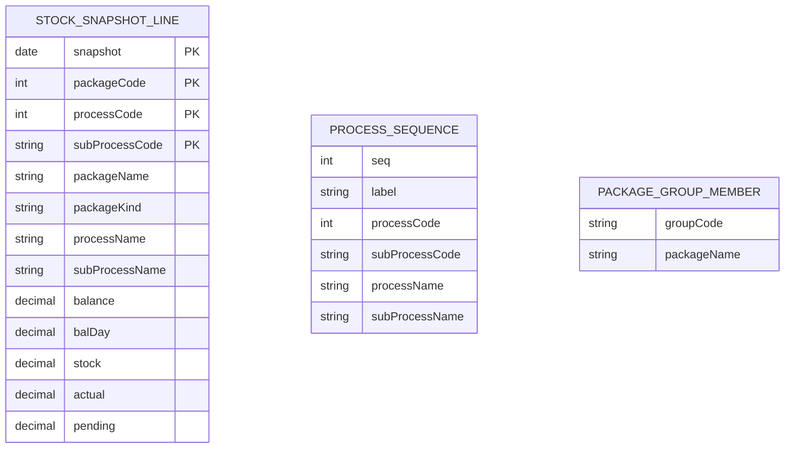

# Data Model Evidence and ER Sketch

The following is a *candidate* model inferred from `src/lib/data/schemas.ts` and `scripts/import-wgpgbl.py`. It is not a production DDL proposal. Confirm business keys and relationships with the AS400 source owner before adding constraints.

## Evidence and Open Questions

- `STOCK_SNAPSHOT_LINE` corresponds to `stockLineSchema` and the importer. The importer rejects duplicate `(snapshot, packageCode, processCode, subProcessCode)` tuples, making this a candidate composite key.
- `PROCESS_SEQUENCE` corresponds to `processSeqSchema`; no uniqueness rule or confirmed foreign key is expressed by the JSON schema.
- `PACKAGE_GROUP_MEMBER` represents `package-groups.json`, whose schema is a string-to-array mapping. Whether package names are stable identifiers is unknown.
- `packageSchema`, `stockGroupSchema`, and `dashboardSchema` may be derived/view models rather than normalized persistence entities.
- The schemas do not establish relationship cardinality or referential integrity. The sketch therefore omits unsupported relationships.

## DB2 for i Decisions to Confirm

Confirm IBM i release and SQL support, library/schema and naming conventions, CCSID, decimal precision/scale, date and timezone mapping, journal/commit requirements, indexes, retention, and whether historical snapshots are append-only. Do not translate illustrative attribute names directly into production identifiers without checking local conventions and limits.
